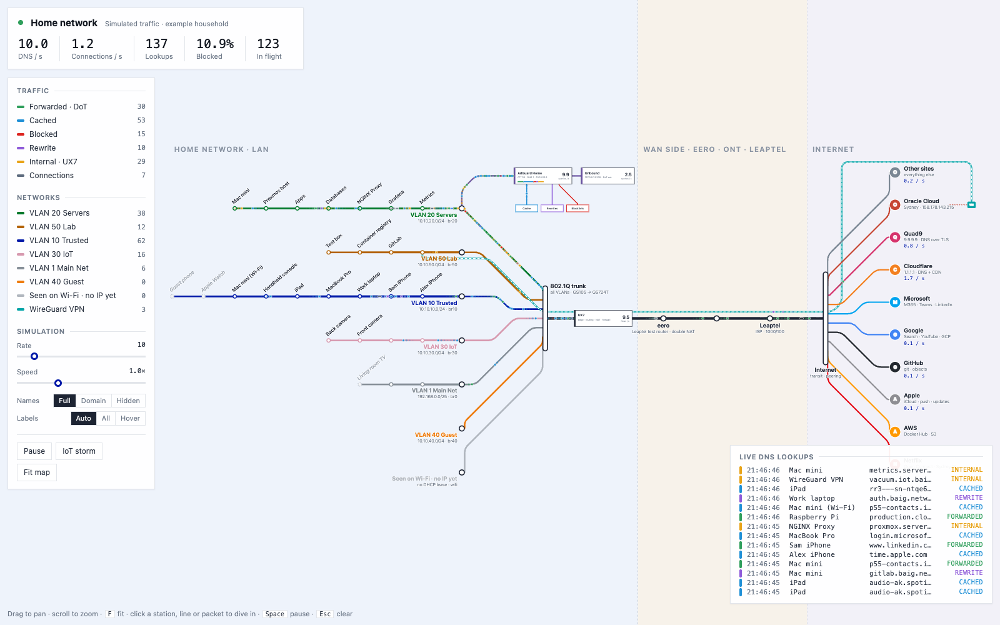
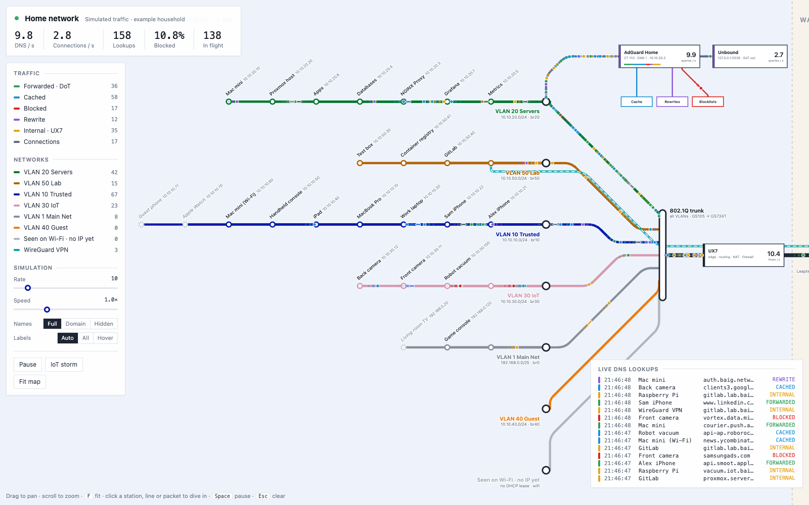
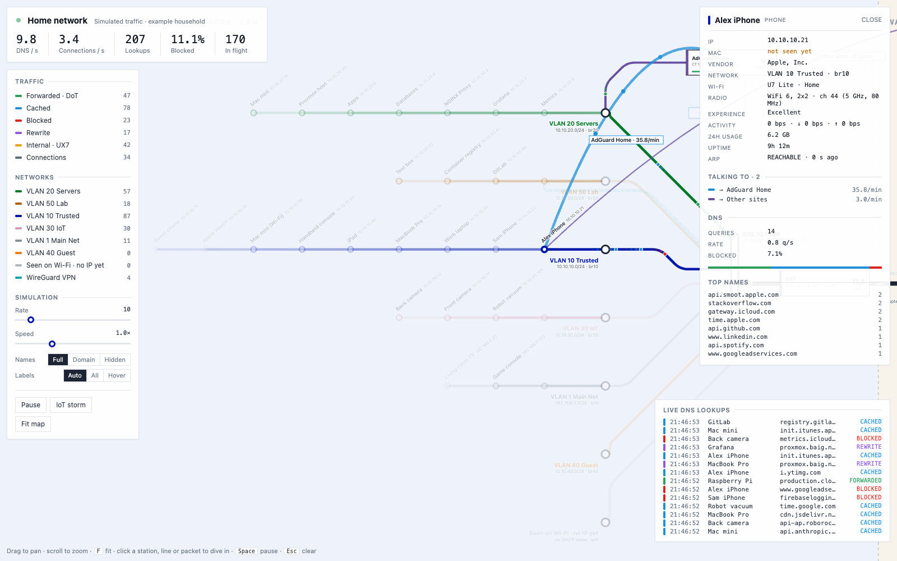
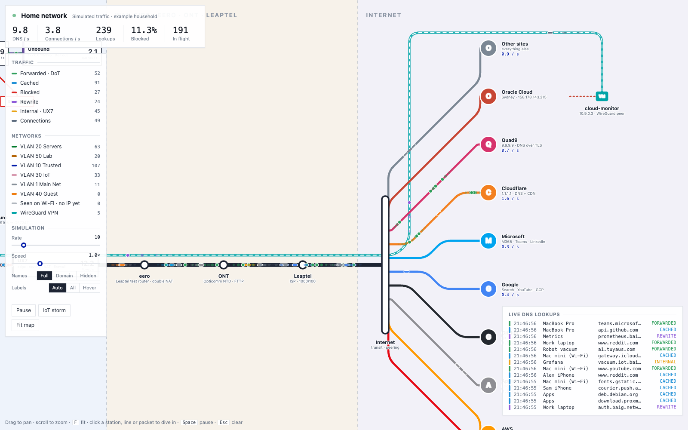
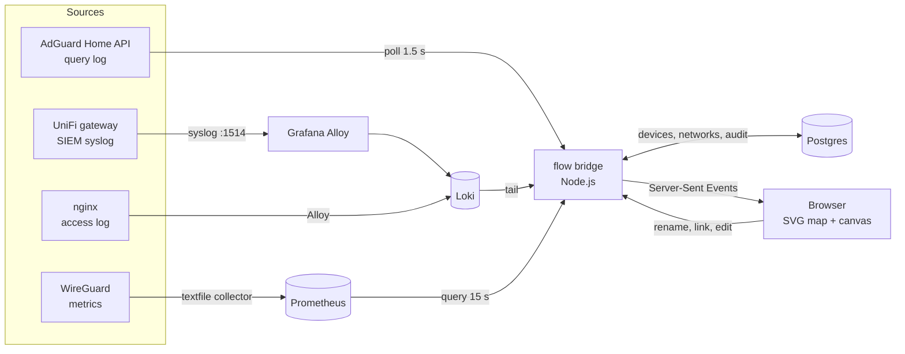

# dns-flow

A live, London Underground style map of a home network: every DNS lookup, every connection and every VPN session moving along the lines in real time, from the device that made it, through VLANs, the router and the ISP, out to the networks on the internet that answered.



It runs against a real homelab (UniFi gateway, AdGuard Home + Unbound, WireGuard, Loki, Prometheus) and also has a built-in simulator, so the map works with no infrastructure at all.

## What you are looking at

| On the map | Means |
|---|---|
| **Coloured lines** | One line per VLAN. Devices are stations along their VLAN's line. |
| **802.1Q trunk** | Where every VLAN meets before the router. Traffic between VLANs goes up to the UX7 and back down, exactly as routing works. |
| **Black main line** | UX7 (the edge: routing, NAT, firewall) → eero → ONT → ISP → the internet. |
| **Roundels** | The networks your traffic actually reached (Google, Apple, Meta, Akamai, …), worked out from the IP addresses in DNS answers. The top 12 by recent traffic are shown; the rest fold into *Other networks*. |
| **Purple branch** | AdGuard Home and Unbound, with spurs to the cache, rewrites and blocklists. |
| **Teal dashed tunnel** | A WireGuard VPN peer. It runs from the peer's cloud, through the internet, the ISP and the UX7, to the WireGuard server on the lab VLAN. |
| **Round dots** | DNS lookups, coloured by outcome: forwarded over DoT, cached, blocked, rewritten, answered locally. |
| **Pill dots** | Connections: to the network that owns the answer IP, or into the reverse proxy. |
| **Amber dashed stations** | Devices seen on the network that nobody has named yet. |

## Screenshots

| | |
|---|---|
|  **The LAN.** VLAN lines with their devices, merging into the trunk. |  **Deep dive.** Click a device: everything else fades, only its own traffic keeps moving, and arcs show who it talks to and how often. |
|  **The internet side.** The WAN chain, destination networks, and a VPN peer's tunnel. | |

## Features

- **Real traffic, live.** DNS from the AdGuard Home API every 1.5 s; Wi-Fi joins, leaves, roams and DHCP leases from the UniFi gateway's syslog; reverse-proxy hits from nginx; VPN peers from WireGuard metrics.
- **Dynamic internet.** Answer IPs are mapped to the network that owns them (ASN and organisation) with a local copy of the [iptoasn.com](https://iptoasn.com) database, so no browsing data is sent to a third party.
- **Deep dive.** Click any station, router, line or network: the rest of the map fades, its own packets keep flowing, and arcs show every conversation with its rate per minute.
- **Device registry.** A small Postgres database holds friendly names. Unknown MACs appear on the map; click one to name it, set its type and owner, or link it to an existing device (private Wi-Fi MACs rotate). Every edit is audited with the signed-in user.
- **Editable networks.** Rename, pin, hide or merge the destination networks (for example, merge two ASNs that are the same company).
- **Observed connections.** Turn on logging for the LAN → internet firewall policy and connections become observed flows instead of being inferred from DNS.
- **Simulator.** `?sim` runs the whole map on an example household with synthetic traffic.

## How it works



The bridge keeps the current state (stations, VPN peers, destination networks), classifies each event and streams it to every open map. The browser draws the network as SVG and the moving traffic on a canvas; it has no framework or build step.

| Source | What it gives the map | Latency |
|---|---|---|
| AdGuard `/control/querylog` | every lookup: client, name, outcome, upstream, latency, answer IPs | ~1.5 s |
| UniFi syslog via Loki | DHCP (IP ↔ MAC ↔ hostname ↔ VLAN), Wi-Fi join/leave/roam, firewall flows | ~1–2 s |
| nginx access log via Loki | real connections into internal services | ~1–2 s |
| Prometheus `wireguard_peer_*` | VPN peers: up, handshake age, endpoint location and ASN | ~15–45 s |
| iptoasn.com (downloaded daily) | IP → ASN, organisation, registration country | local |

## Quick start

### Simulator only

```sh
python3 -m http.server 5173
open "http://localhost:5173/?sim"
```

### Live

```sh
npm ci
export DATABASE_URL=postgres://flow:secret@db:5432/flow
export ADGUARD_URL=http://10.10.20.2
export ADGUARD_AUTH=$(printf 'user:password' | base64)
export LOKI_URL=http://10.10.20.5:3100
export PROM_URL=http://10.10.20.5:9090
npm start
open http://localhost:8787
```

The database schema is created on first start and seeded from `data/clients.js` if it exists, otherwise from `data/clients.example.js`. `data/clients.js` is gitignored: copy the example, fill it in from your UniFi client list, and keep it private.

| Variable | Default | Meaning |
|---|---|---|
| `PORT` | `8787` | HTTP port for the map, API and event stream |
| `DATABASE_URL` | — | Postgres for the device registry |
| `ADGUARD_URL` | `http://10.10.20.2` | AdGuard Home web/API address |
| `ADGUARD_AUTH` | — | base64 of `user:password` for AdGuard |
| `LOKI_URL` | `http://10.10.20.5:3100` | Loki with `{job="unifi"}` and `{job="nginx"}` streams |
| `PROM_URL` | `http://10.10.20.5:9090` | Prometheus with WireGuard peer metrics |
| `WIREGUARD_HOST` | `10.10.50.20` | The WireGuard server's LAN IP (VPN clients are NATed to it) |
| `DATA_DIR` | `./var` | Where the ASN database is cached |

## Setting up the sources

**UniFi gateway → Loki.** In UniFi Network, set *Activity Logging (SIEM server)* to the host running Grafana Alloy, port 1514. Add [`deploy/alloy-unifi-syslog.alloy`](deploy/alloy-unifi-syslog.alloy) to Alloy's config. Lines arrive as `{job="unifi"}` with `ident`, `level` and `device` labels. To see observed connections, enable logging on the LAN → internet allow policy.

**Grafana.** [`deploy/grafana-unifi-dashboard.json`](deploy/grafana-unifi-dashboard.json) is a UniFi router dashboard for those logs: Wi-Fi joins/leaves, roams to other APs, DHCP leases by VLAN, warnings by program and a log browser. Import it and pick your Loki data source.

**AdGuard Home.** The bridge reads the API, not `querylog.json`: AdGuard buffers up to `size_memory` entries before writing the file, so the file can lag by minutes.

**WireGuard.** Any exporter that provides `wireguard_peer_handshake_age_seconds` and `wireguard_peer_geo_info` (peer, endpoint, city, ASN) works.

## Deploying

- [`Dockerfile`](Dockerfile) and [`deploy/docker-compose.example.yaml`](deploy/docker-compose.example.yaml) run the bridge, which also serves the map.
- [`deploy/nginx-flow.conf`](deploy/nginx-flow.conf) is a reverse-proxy vhost. The event stream needs `proxy_buffering off`. Put an SSO gate (for example oauth2-proxy with `auth_request`) in front: the map shows device names and browsing activity.

In the author's homelab the whole stack is deployed with Ansible from [ahmedbaig/Proxmox](https://github.com/ahmedbaig/Proxmox): the bridge as a Compose stack on the apps container, the `flow` database on the shared Postgres, the Alloy syslog receiver on the metrics container and the vhost behind Entra ID SSO.

## API

| Method | Path | |
|---|---|---|
| `GET` | `/api/stream` | Server-Sent Events: `snapshot`, `stations`, `destinations`, `dns`, `conn`, `flow`, `wifi`, `peers` |
| `GET` | `/api/stations` | Current stations (named devices, unknown MACs, VPN peers) |
| `GET` | `/api/devices` | Named devices |
| `POST` | `/api/stations/:id/name` | Name an unknown station `{ name, type, owner }` |
| `POST` | `/api/stations/:id/assign` | Link an unknown station to a device `{ deviceId }` |
| `PATCH` | `/api/devices/:id` | Edit a device `{ name, type, owner, notes, hidden }` |
| `GET` | `/api/networks` | Destination networks on the map |
| `PATCH` | `/api/networks/:key` | Rename, pin or hide a network |
| `POST` | `/api/networks/:key/merge` | Merge a network into another `{ into }` |

## Honest limits

- **Connections are inferred from DNS** unless firewall logging is on: an answer is not proof that a connection was made, and anything that connects by IP alone is invisible.
- **VPN clients behind NAT** all look like the WireGuard server to AdGuard and nginx. The bridge attributes that traffic to the active peer, and marks it as a best guess when several peers share the NAT.
- **Which DoT resolver** Unbound used for a given query is not logged, so forwarded lookups are split between Cloudflare and Quad9 by a stable hash.
- **Access points without their own syslog** (a U7 Lite behind a UniFi Express) only show joins, through the gateway's roam notices; leaves show when the DHCP lease lapses.
- **Registration country** from the ASN table is where a network is registered, not where the server is.

## Layout

The map is drawn from code, not a file: `src/topology.js` holds the coordinates (VLAN rows, trunk, main line, destination column) and the routing rules, `src/map.js` draws the SVG, `src/dots.js` animates traffic on a canvas and `src/conversations.js` drives the deep dive.

## License

MIT
